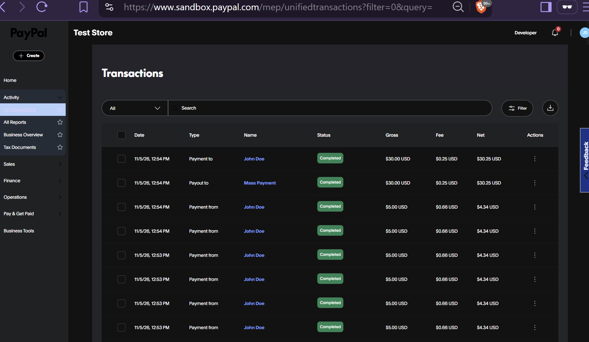
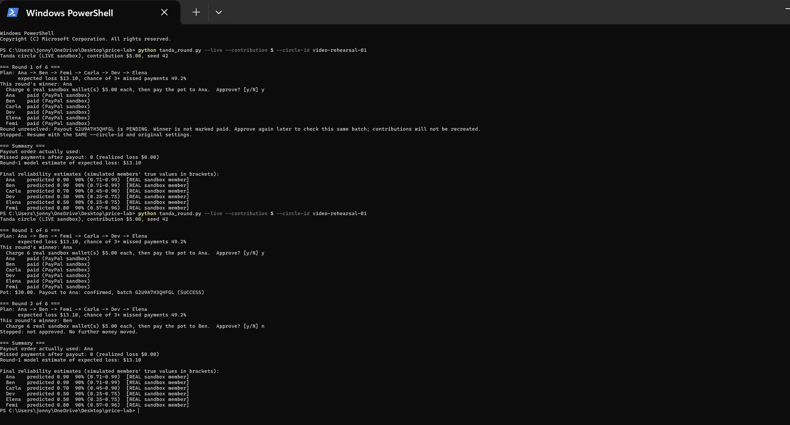
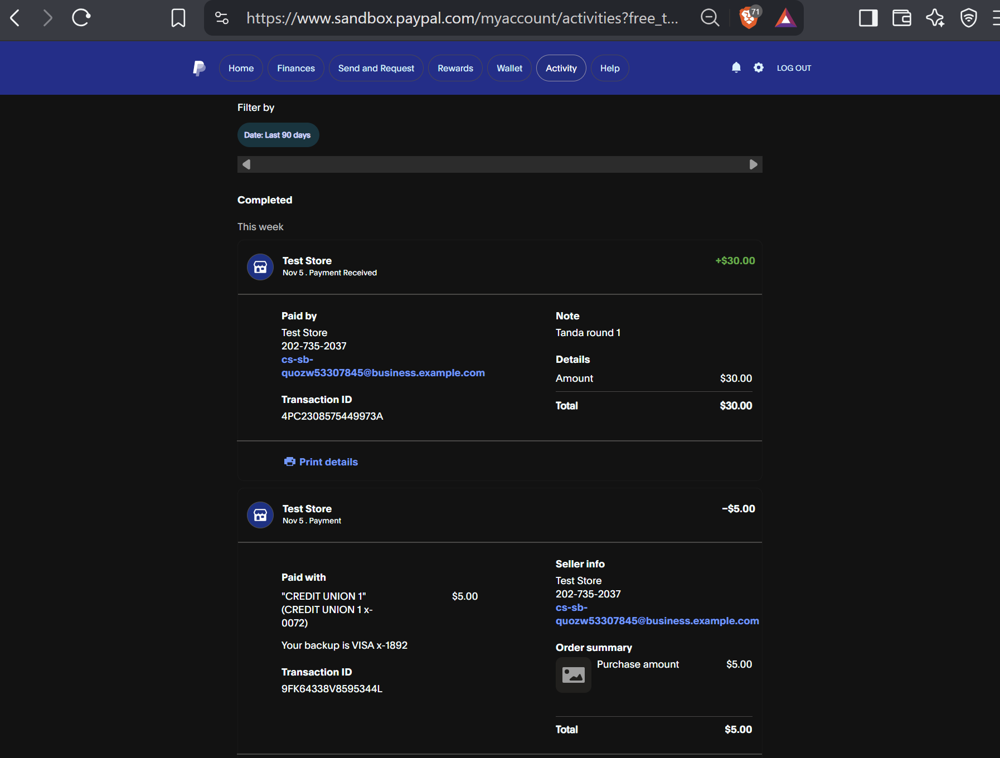
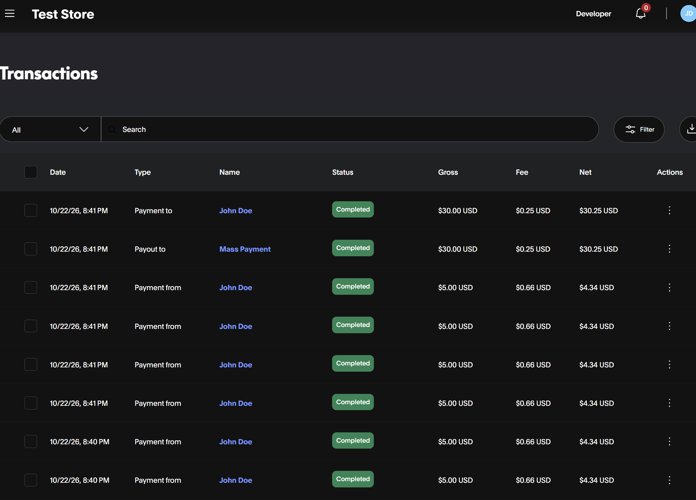
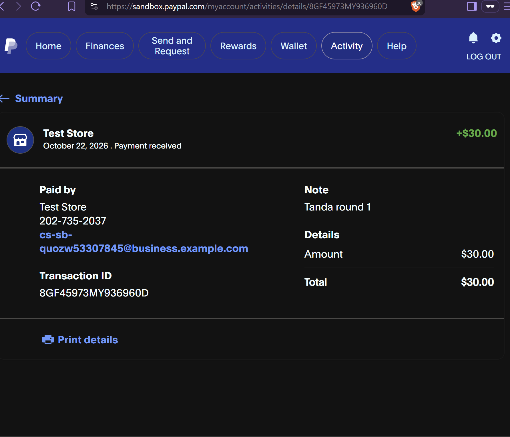
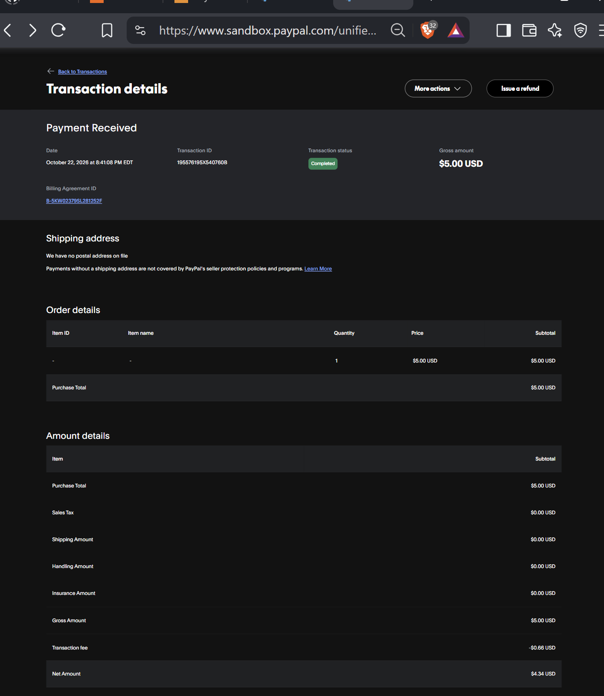

# Tanda

Savings circles run on trust and spreadsheets, so Tanda estimates each member's
reliability, recommends the payout order with the least expected loss, and moves
contributions and payouts through PayPal's sandbox. An AI coordinator (Google Gemini)
explains the circle in plain language and can propose the next round, but only a person
can approve it. (Prototype: tested on simulated circles.)

Built for the PayPal AI Hackathon (Oct 2026). Everything uses PayPal's **sandbox**:
no real money moves, and all member payment histories used for the statistics are
**simulated**.

## Judge quick start

| Entry point | What is functional | What to expect |
|---|---|---|
| [Hosted Render demo](https://tanda-wma5.onrender.com/) | Statistics, Gemini coordinator, proposal and human approval | Payment rounds are simulated; no PayPal calls |
| Local terminal, `tanda_round.py --live` | PayPal sandbox contributions and payout, human approval, local recovery journal | Uses the reviewer's own sandbox accounts and test money |
| [Local reproduction guide](docs/LOCAL_SETUP.md) | Fresh-clone setup, no-key dry run, optional Gemini, all six sandbox wallets | No developer's private keys or wallet file is required |

**November 5 evidence:** [six completed contributions](docs/06-six-contributions-Nov05.png),
[the same payout batch from PENDING to SUCCESS](docs/04-terminal-recovery-Nov05.png),
and [the winner's matching 30 USD receipt](docs/05-winner-receipt-Nov05.png).
The two outgoing 30 USD activity rows are batch/item views, not two separate pots.

## Live demo

**https://tanda-wma5.onrender.com/**

Hosted on Render's free plan, so the first visit after a quiet period can take about a
minute to wake up. The hosted page runs as a **dry run**: it makes no PayPal calls (see
Limitations). The PayPal sandbox flow is documented under "Results so far" below and
illustrated by the sandbox screenshots below. A recorded walkthrough will be linked here once uploaded.

To try it:

1. Read the member table and the "Lowest estimated loss under this model" box.
2. Click **Propose next round**, then **I approve: run this round**. Only that button
   runs a round.
3. Repeat, or ask the **AI coordinator** a question (for example "Who needs attention?").
   It explains the numbers and can propose a round, but it cannot approve one.

## The idea in plain English

In a rotating savings circle (a tanda, susu, or hui), 6 people each put in $100 a
month, and one person takes the whole $600 pot each month until everyone has had a
turn. Whoever is paid early has effectively borrowed from the others. If they stop
paying afterward, the rest lose money. So the payout order matters, and Tanda uses
probability to choose it.

## Who it is for and why it matters

**The practice.** Friends and family pool money and take turns receiving it in
many communities. Related traditions include tandas, susus, cundinas and paluwagan.
[Mission Asset Fund describes this shared practice](https://www.missionassetfund.org/programs/)
and [how tandas helped inspire its Lending Circles program](https://www.missionassetfund.org/about/).
The traditions and organizers already exist; this prototype explores one supporting tool.

**Who this prototype is for.** A small-circle organizer who has payment records and
wants to understand estimated payment risk and uncertainty before discussing payout order.
Tanda estimates reliability, compares orders under a stated model, and explains the
results through a Gemini coordinator. The organizer retains approval.

**What is demonstrated.** A simulation study, a working dry-run web app, and sandbox
contributions and payouts. These demonstrate implementation and model behavior;
they do not establish improved outcomes for real communities.

**What needs testing.** Organizers may prioritize urgent needs, fairness, and existing
agreements over the lowest estimated loss. The model currently does not represent
those priorities. Its assumption that missed payments arise after payout also needs
checking against real practice. I have not tested Tanda with real organizers or real
payment histories. The next step is voluntary feedback on the assumptions and explanations.

## Status

| Piece | File(s) | Status |
|---|---|---|
| Estimate each member's on-time probability (Bayes) | `tanda_stats.py` | Built, runs on simulated data |
| Score all payout orders, pick the least risky | `tanda_loss.py` | Built, runs on simulated data |
| PayPal client (token reuse, errors, orders, payouts, vault) | `paypal_client.py` | Built, tested against the sandbox |
| Create a sandbox order | `create_order.py` | Works |
| Send a sandbox payout | `create_payout.py` | Works (payout arrives in the buyer account) |
| Save a member's PayPal wallet (approve once) | `vault_test.py`, `tanda_members.py` | Works; all six members have saved wallets |
| Charge a saved wallet with no one present | `vault_charge_test.py` | Works |
| Run a whole circle round by round, with human approval | `tanda_round.py` | Built. Dry run verified; live round 1 verified with six sandbox accounts |
| Agent tool layer (what an AI is allowed to see and propose) | `tanda_tools.py` | Model-independent tool layer; integrated with Gemini |
| AI coordinator (Gemini reads the circle through the tools and explains it) | `tanda_agent.py` | Built; answered a question with a real Gemini key |
| Web page (Streamlit): status, safest order, propose then human approves | `app.py`, `tanda_view.py` | Built; runs locally, dry-run flow verified |
| Hosted demo (Render, free plan, dry run) | | Deployed: https://tanda-wma5.onrender.com/ |
| Simulation study (validates the model against known truth) | `tanda_study.py` | Built and run |

## How it works

1. **Estimate** (`tanda_stats.py`). Each member has a hidden probability of paying
   on time. From their payment history (1 = on time, 0 = late or missed), Bayes'
   theorem updates a belief over a grid of 199 candidate values (0.5% to 99.5%).
   Output: a predicted on-time probability and a 90% credible interval.
2. **Score orders** (`tanda_loss.py`). For every possible payout order (720 for 6
   members), compute the distribution of total missed payments, then the expected
   dollar loss and the chance of a bad outcome (3 or more missed payments).
3. **Move money** (`paypal_client.py`). Contributions are charged to each member's
   saved PayPal wallet, and the round's pot is sent to the winner with the Payouts
   API. Only a confirmed payment decline can become a 0 in a post-payout member's history; technical or uncertain outcomes stop the round without changing reliability.
4. **Run the circle** (`tanda_round.py`). Each round: plan, ask a human to approve,
   collect contributions, record who missed, send the pot. Dry runs simulate all payments. Live sandbox mode requires a saved wallet and payout email for every member; simulated contributions cannot fund a PayPal payout.

### Model assumptions

- N members each pay C per round. The member in slot s receives the pot in round s.
- A member who has **not yet** received the pot keeps paying. The risk is a member
  who already took the pot and then misses payments (they still owe N - s).
- Given a member's true on-time probability, missed payments are binomial. Members
  are independent. A late payment counts as a missed one.
- Without the second assumption every order would have the same total loss, and
  there would be nothing to optimize.
- Consequence: payments by members who have not been paid yet are treated as
  uninformative, so only post-payout payments update a member's history.

### Statistics used

Bernoulli and binomial trials, Bayes' theorem, the law of total probability, PMFs
and CDFs (tail probability), convolution of PMFs, exhaustive search over all N!
orders, and simulation (repeating a random experiment many times to check the
model: interval coverage, and paired comparisons with standard errors).

## How PayPal is used

PayPal is the money layer: in a live circle, every contribution and every payout goes
through PayPal's sandbox. All calls go through one small client (`paypal_client.py`).

| What Tanda does | PayPal capability | Endpoint | Status |
|---|---|---|---|
| Authenticate | OAuth 2.0 client credentials | `POST /v1/oauth2/token` | Works; the token is reused until shortly before it expires |
| Save a member's wallet (they approve once) | Orders API with Vault (save during purchase) | `POST /v2/checkout/orders` with `payment_source.paypal.attributes.vault`, then `POST /v2/checkout/orders/{id}/capture` | Verified for all six members (vault status VAULTED) |
| Collect a contribution with nobody present | Charge a saved wallet through the Orders API | `POST /v2/checkout/orders` with `payment_source.paypal.vault_id` | Verified: charge completed, receipt reason "Billing Agreement" |
| Pay the round's winner | Payouts API | `POST /v1/payments/payouts`, `GET /v1/payments/payouts/{id}` | Verified: the recipient received the money |
| Simulate a declined charge | `PayPal-Mock-Response` test header (sandbox only) | on order creation | Written but **not tested** |

**Evidence from sandbox runs** (October 22, 2026; test money only):

- Six completed contributions of 5.00 USD each appear in the Business activity.
- The saved-wallet receipt shown below has transaction ID `195576195X540760B`,
  billing agreement `B-5KW02379SL281252F`, 5.00 USD gross, a 0.66 USD fee and 4.34 USD net.
- The winner's screenshot confirms 30.00 USD received, with note "Tanda round 1"
  and recipient transaction ID `8GF45973MY936960D`.
- Older chat notes contain other order, batch and transaction IDs. They are not
  assumed to be the same transactions as these screenshots, and are omitted here
  to avoid an unverified mapping.

**Design choices around the money**

- A person reviews and approves live sandbox rounds. The AI tool list excludes execution.
- Live mode requires all member wallets and payout emails before it can start.
- A private local journal records each operation before a payment request and saves
  returned order and batch IDs. Successful contributions are reused when the same
  circle resumes, rather than recreated. Intent identifiers stay stable for that operation.
- Confirmed completed captures count toward the gross pot. A pending/failed payout
  does not mark the winner paid or advance the round. Pending batches are checked again.
- A lost response blocks uncertain writes; it is not blindly retried. The read-only
  recovery script can attach an existing matching order/batch after manual lookup.
- Authentication/service errors do not lower a member's reliability. Only confirmed
  payment declines are counted as missed payments, and only post-payout histories update.
- The hosted demo makes no PayPal calls. Keep `ENABLE_LIVE` unset on public hosting.

**Fees and the prefunded sandbox balance.** The six contributions total 30.00 USD
gross. At the 0.66 USD fee shown on each receipt, net collections total 26.04 USD.
The outgoing 30.00 USD payout also carries a 0.25 USD sandbox fee. The existing
Business test balance covers the 4.21 USD difference. This prototype pays the gross
pot; it does not solve fee funding for production circles.

**Verification scope.** On November 5, 2026, the revised local runner collected
six 5 USD sandbox contributions. Payout batch `G2U9A7H3QHFGL` first returned
`PENDING`, so the winner was not marked paid and the runner stopped. Resuming the
same `video-rehearsal-01` circle checked the saved operations and that same batch,
then confirmed `SUCCESS`. Ana's recipient receipt is transaction
`4PC2308575449973A`, 30 USD, note "Tanda round 1". Round 2 was declined by the
operator before execution. The terminal and matching receipts are linked below.
Automated tests cover additional failure and recovery cases using fake responses.
Rounds 2–6 and the PayPal mock-decline header remain unverified against the sandbox.
Permanently failed payouts require investigation; no replacement is sent automatically.

**Tools used:** PayPal REST APIs (Orders, Vault, Payouts) in the sandbox; Google
Gemini API for the coordinator; Render for hosting; Streamlit for the page; Python with
`requests`.

### PayPal sandbox screenshots

All images use PayPal sandbox test money.

**November 5 — six contributions:** six completed 5 USD incoming payments and the
completed outgoing payout are visible in the Business account's activity.



**November 5 — pending payout recovery:** the same batch `G2U9A7H3QHFGL` changes
from PENDING to SUCCESS on resume. Round 2 is stopped before execution. The repeated
"paid" lines on resume report the existing contributions, not additional charges.



**November 5 — recipient confirmation:** Ana receives 30 USD with note "Tanda round 1",
transaction `4PC2308575449973A`.



#### Earlier evidence — October 22

The images below document an earlier run, separate from the November 5 rehearsal.


All transactions below use sandbox test money.

**Six contributions collected:** six completed payments of
5.00 USD each, totaling 30.00 USD gross before fees.



**Winner paid:** the recipient received 30.00 USD with the
note “Tanda round 1.”



**Saved-wallet contribution:** a completed 5.00 USD payment
linked to a billing agreement. The receipt shows a 0.66 USD
fee and 4.34 USD net.




## Agent safety design

A Gemini AI model coordinates the circle, but it cannot move money. `tanda_tools.py`
gives it four tools: look at the circle's status, estimate one member, score the
payout orders, and propose the next round. A proposal moves nothing. Running a round
is a separate function (`approve_and_run`) that a human triggers and that is not in
the list of tools the AI can call; a request for it by name is refused. All numbers
come from the Python statistics, not from the model, and the model is never shown
the simulated members' hidden true probabilities.

## AI tool used

Google's Gemini API (the `generateContent` endpoint, called with plain `requests`).
It acts as a coordinator: given a question, it asks for one or more of four safe tools
(circle status, one member's estimate, payout-order scoring, propose the next round),
reads the results our Python code produced, and explains them in plain language.
It does no math, never sees the simulated members' hidden true probabilities, cannot
approve a round, and cannot move money. The page shows which tools it used for each
answer, and a request for a tool outside the safe list is refused and shown as
"(refused)". Each visitor gets 15 questions and the server 300, to protect the free quota.

## Results so far (one simulated circle, seed 42)

Six simulated members, 8 months of history each, **100 USD contributions per member per round**. Model-estimated numbers (the app defaults to 5 USD, so its dollar estimates are twenty times smaller):

| Order | Expected loss | Chance of 3+ missed payments |
|---|---|---|
| Best: Ana, Ben, Femi, Carla, Dev, Elena | $262 | 49.2% |
| Random order (average over all 720) | $426 | 80.9% |
| Worst | $590 | 95.6% |

This is a single run, scored with the model's own beliefs. The multi-run validation study against known true probabilities is reported below.

Playing that circle out with `tanda_round.py` (dry run, seed 42, $100 contributions),
the payout order held for all six rounds and 4 payments were missed after payout
(realized loss $400), versus the round-1 model estimate of $262. That is one random
circle, not a contradiction: the estimate is an average and single circles vary.
A member who missed payments after being paid (Femi) saw his estimate fall from
0.80 to 0.62 (his true simulated value is 0.45).

Live sandbox check (round 1): the circle ran with six saved sandbox wallets. All six
members were charged $5.00 through PayPal, the pot was $30.00, and a payout was sent
to the winner (the recipient screenshot below now confirms receipt). I stopped after round 1; rounds
2 to 6 have not been run live.

## Validation study (`python tanda_study.py`, seed 2026)

Simulated members whose true on-time probabilities are known, so the model can be
checked against the truth. The data are generated from the model's own assumptions
(independent payments, a fixed probability per member), so this shows how the
method behaves, not that real circles behave this way.

**Study A: do the 90% credible intervals cover the true value?** (2000 simulated
members per cell)

| True on-time probability | 4 months | 8 months | 16 months | 32 months |
|---|---|---|---|---|
| 0.45 | 95% | 92% | 92% | 92% |
| 0.60 | 98% | 94% | 88% | 90% |
| 0.80 | 97% | 95% | 89% | 93% |
| 0.90 | 95% | 97% | 94% | 87% |
| 0.95 | 81% | 94% | 96% | 93% |
| 0.98 | 93% | 84% | 95% | 87% |

Averaged over true values drawn from the grid: 90%, 90%, 91%, and 91% at 4, 8, 16
and 32 months, close to the 90% target. For a single fixed true value, coverage varies
from about 81% to 98% (the weakest cells: 0.95 with 4 months, 0.98 with 8 months, and
0.90 with 32 months), so intervals are approximately but not exactly calibrated.

**Study B: expected loss by strategy** (200 simulated circles per row; true
probabilities drawn uniformly from 0.40 to 0.98; $100 contributions; every order
is scored exactly using each member's true probability; lower is better)

| History per member | Random order | Naive (raw fraction) | Tanda (Bayesian) | Best possible |
|---|---|---|---|---|
| 4 months | $466 | $373 | $373 | $321 |
| 8 months | $463 | $356 | $359 | $319 |
| 16 months | $468 | $346 | $346 | $323 |
| Mixed (2, 4, 8 or 16) | $470 | $379 | $371 | $325 |

Findings:

- The recommended order closes about 64%, 72% and 84% of the gap between a random
  order and the best possible order at 4, 8 and 16 months. More history helps, with
  diminishing returns.
- With equal-length histories, the Bayesian ranking is no better than ranking by
  raw on-time fraction (differences of -$0.2, -$2.4 and -$0.3 per circle, each within
  about two standard errors, so consistent with no difference). This is expected: for
  equal lengths the posterior mean is an increasing function of the raw count.
- With unequal histories, Tanda saves $7.9 per circle (standard error 2.0, same
  circles compared) over the naive ranking, because shrinkage stops a member with
  2 perfect payments from outranking one with 15 out of 16.
- The remaining value of the Bayesian approach is the uncertainty: credible
  intervals and the probability of a bad outcome, which a plain ranking cannot give.

## What went wrong along the way

- **Two different Client IDs.** The Buy Button's generated snippet has its own
  Client ID, separate from the Default Application's Client ID and Secret. The
  Python code uses the Default Application pair.
- **Sandbox vs. real accounts.** The "Business account" in the guides is a free
  sandbox test account that PayPal creates automatically, not a real one.
- **A seller can't pay itself.** Paying a test button while logged in as the
  sandbox Business account fails. Use a private window and a sandbox Personal account.
- **Payouts start as PENDING.** The client checks the status again afterward.
- **Vault orders label their link differently.** A normal order's approval link is
  `approve`, but a vault order's is `payer-action`, so the client handles both.
- **Fees.** The sandbox simulated a $0.66 fee on a $5.00 charge, so money collected
  in a round is slightly less than the sum of contributions.

## Limitations (honest)

- **Simulated data.** There is no real circle data. Histories are generated from
  known probabilities, so results show how the method behaves, not how real people behave.
- **Sandbox only.** Pooling and paying out real money is regulated, and saving
  payment methods for live use likely needs extra PayPal approval. Neither is covered here.
- **Small samples mislead.** With 8 months of history, a 45% payer who got lucky
  looks reliable (the model ranked "Femi" third). The 90% intervals show this uncertainty.
- **The probability grid is an approximation.** An earlier version used 19 candidate
  values (5% to 95%) and could not represent a member whose true rate is above 0.95:
  the study found 0% interval coverage for a 0.98 member. Refining the grid to 199
  values (0.5% to 99.5%) raised that to 84% to 95% and brought Ana's 8-for-8
  prediction to 0.90, matching the exact continuous answer (9/10) to within 0.002.
  Interval endpoints still move in steps of 0.005. An exact continuous (Beta)
  posterior is left for later.
- **The order search confirmed a simple rule.** Across 200 simulated circles, the
  best order always matched "most reliable first." The added value is the risk
  numbers, not a surprising order.
- **The payout order never changes mid-circle.** Members already paid are fixed,
  and (by the model's own assumption) unpaid members' estimates never update, so
  re-planning each round cannot change who goes next. In 60 simulated circles the
  plan never changed. The per-round learning still updates risk estimates for
  members who have already been paid, which flags who needs follow-up, but it does
  not reorder anyone. Loosening the assumption (letting every payment update
  beliefs) is a planned sensitivity check.
- **The hosted demo is a dry run.** It shows the statistics, the approval flow, and the AI
  coordinator, but makes no PayPal calls, so a stranger cannot trigger sandbox payments
  from this account. The live PayPal runs (charges, payouts) are documented in this README
  and illustrated by the sandbox screenshots above. The free Render plan also goes to sleep when idle.
- **AI model names change.** Google renames and retires Gemini models often, so the
  model is a setting (`GEMINI_MODEL`) rather than a promise. On Google's free tier,
  questions and answers may be used to improve its products, which is acceptable here
  only because every member and payment history is simulated.
- **The AI is only as good as its tools.** It can explain the numbers but cannot check
  them, and a language model can still phrase things imprecisely, so the page shows the
  underlying table and the tools it used.
- **Live runs are lightly tested.** Round 1 of a live run is verified; the
  `--mock-decline` option (asking the sandbox to simulate a declined charge) is untested.
- **Sandbox approval is not guaranteed.** The recorded successful charges do not
  establish how failures behave in real use. Payment histories are simulated and
  the sandbox mock-decline header is still unverified against PayPal.
- **Local recovery only.** Live journals are local files protected against concurrent
  processes on the same machine. They are not a distributed payment ledger. Do not
  delete journals or choose a new circle ID to retry an uncertain round; doing so
  discards the record needed to prevent repeated payments. Live mode is for a single
  local operator, not public hosting or production money.
- **Payment state is conservative.** Unknown outcomes and permanently failed payouts
  stop progress for investigation. There is no automatic compensation/refund system.

## Run it

Follow [the complete local reproduction guide](docs/LOCAL_SETUP.md). It includes
fresh-clone commands for Windows, macOS and Linux; expected results; optional Gemini
setup; all six sandbox wallet enrollments; and the one-round PayPal reproduction.
The fresh-clone dry-run path was checked on Python 3.12.14 without any private
credential or wallet files. The optional sandbox path is supported by the November 5
rehearsal evidence above, not a fresh run with a second merchant's accounts.

Quick commands after installing `requirements.txt` in your environment:

```text
python -m streamlit run app.py
python tanda_round.py --yes --contribution 5 --seed 42
python -m unittest discover -s tests -v
```

These commands do not make PayPal calls. Gemini is optional locally; the statistics
and simulated rounds work without API keys. For actual PayPal sandbox calls, first
complete all six wallet setups, then use `--live` with a unique circle ID as described
in the guide. Keep `ENABLE_LIVE` unset on public hosting.

### Recovering an uncertain sandbox request

1. Stop and keep the same journal, circle ID and original settings. Do not rerun the
   standalone payment helpers as a workaround; those create separate test payments.
2. If an order ID was saved, approving again reads that existing order. A confirmed
   capture can be recognized even if its earlier response was lost. Pending batches
   are also read again without creating another payout.
3. If an order-creation response was lost before its ID could be saved, find the
   existing order in PayPal's developer logs, then reconcile it with:
   ```text
   python tanda_recover.py --circle-id rehearsal-01 --round 1 --member Ana --order-id ORDER_ID
   ```
4. For a lost payout-creation response, find the existing batch and use:
   ```text
   python tanda_recover.py --circle-id rehearsal-01 --round 1 --payout-batch-id BATCH_ID
   ```
   Add the original `--seed` and `--contribution` if nondefault. The script makes only
   read-only PayPal calls, validates the operation reference, and never sends money.
   An unresolvable unknown outcome or permanently failed payout remains blocked;
   investigate it in PayPal rather than deleting the journal or changing circle ID.


# Roadmap

Done in this submission

 - Statistics: Bayesian reliability estimates and risk scoring of all payout orders
 - Validation study on simulated circles (interval coverage, loss versus baselines)
 - PayPal sandbox: saved wallets, charging them with nobody present, payouts
 - Round runner with a human approval step
 - Agent tool layer (read-only and propose-only tools) and a Gemini AI coordinator
 - Streamlit page, hosted on Render (dry run only)
 - Finer probability grid (199 values) to remove the 0.95 ceiling
 - Local sandbox operation journal and regression tests for payment failures and recovery
 - Revised runner verified through round 1 and pending-payout recovery (November 5)

Still to do before submitting

 - Demo video (the link goes at the top of this README once it is uploaded)

Future work (not part of submission)

- Exact continuous (Beta) posterior, once covered in class, to check the grid against the exact answer
- Sensitivity check: compare against a model where every payment updates beliefs
- Try the tool with real circle organizers (with their consent) and real payment histories

## Notes

- Claude was used for coding assistance and explanations during initial development.
  Codex assisted with review, payment-state fixes, tests and submission preparation.
  Google Gemini is the AI service integrated into the running application.
- Created after the hackathon began (Oct 10, 2026). The early Buy Button test was
  setup practice, not part of the project.

## License

MIT
